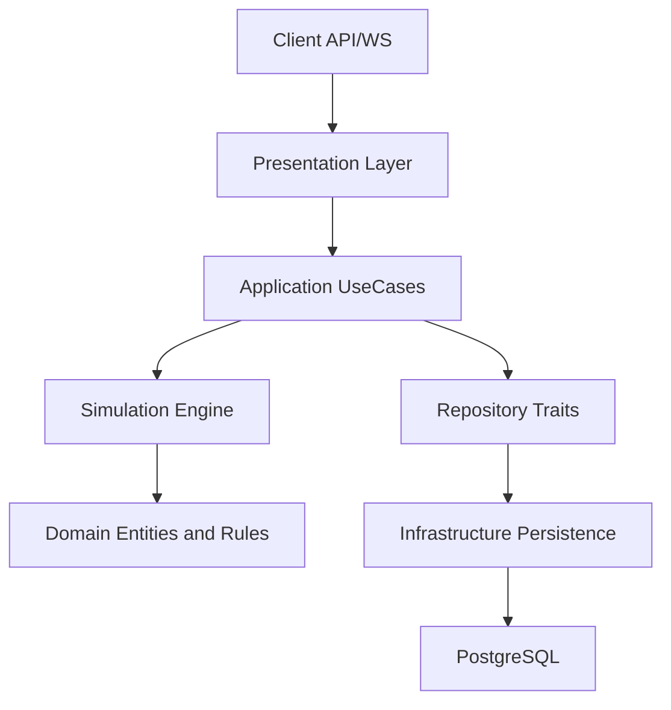

# Mining Tycoon Implementation Plan (Phased)

## Scope & Baseline

- Nguồn yêu cầu: notebook Mining Tycoon (PoW simulation, event-driven, server-authoritative).
- Codebase hiện tại đã có khởi điểm migration + layer skeleton:
  - [Cargo.toml](Cargo.toml)
  - [src/main.rs](src/main.rs)
  - [src/domain/mod.rs](src/domain/mod.rs)
  - [src/domain/entities/mod.rs](src/domain/entities/mod.rs)
  - [src/domain/repositories/mod.rs](src/domain/repositories/mod.rs)
  - [src/application/use_cases.rs](src/application/use_cases.rs)
  - [src/infrastructure/persistence.rs](src/infrastructure/persistence.rs)
  - [migration/src/lib.rs](migration/src/lib.rs)
  - [migration/src/m20260215_000001_baseline_schema.rs](migration/src/m20260215_000001_baseline_schema.rs)

## Target Architecture (Server-Authoritative)

## Phase 0 — Hardening Foundation

### Goal

Ổn định nền tảng chạy migration/reset/rollback/status và chuẩn hóa local dev loop.

### Deliverables

- Verify đầy đủ binaries vận hành local:
  - `cargo run --bin migrate`
  - `cargo run --bin rollback -- 1`
  - `cargo run --bin reset`
  - `cargo run --bin status`
- Chốt schema global-only (không room) trong baseline migration.
- Cập nhật docs vận hành local nhất quán.

### Main Files

- [src/bin/migrate.rs](src/bin/migrate.rs)
- [src/bin/reset.rs](src/bin/reset.rs)
- [src/bin/rollback.rs](src/bin/rollback.rs)
- [src/bin/status.rs](src/bin/status.rs)
- [docs/RUN.md](docs/RUN.md)

### Risks

- Mismatch `DATABASE_URL` và docker credentials.
- Migration feature flags thiếu backend/runtime.

### Exit Criteria

- Reset DB sạch và apply migration thành công 100% trên local.

---

## Phase 1 — Deterministic Engine Core

### Goal

Xây “heartbeat” deterministic: `seq_id`, `server_time_ms`, tick scheduler, event envelope.

### Deliverables

- Engine loop phát sự kiện đều theo tick.
- Event envelope chuẩn: `{seq_id, server_time_ms, event_type, payload}`.
- Persistence event stream vào `event_log`.

### Implementation Steps

- Tạo module engine core:
  - [src/application/use_cases.rs](src/application/use_cases.rs) (tách use case thành nhiều file theo concern)
  - [src/domain/entities/mod.rs](src/domain/entities/mod.rs) (event entity nếu cần)
- Tạo repository methods cho append/read event stream:
  - [src/domain/repositories/event_repository.rs](src/domain/repositories/event_repository.rs)
  - [src/infrastructure/persistence.rs](src/infrastructure/persistence.rs)
- Tạo API health + engine status:
  - [src/main.rs](src/main.rs)

### Testing

- Unit test monotonic `seq_id`.
- Unit test idempotent event append order.

### Risks

- Race condition khi nhiều producer ghi event.

### Exit Criteria

- Chạy 5–10 phút không duplicate/missing `seq_id`.

---

## Phase 2 — Mempool + PoW + Propagation

### Goal

Mô phỏng network sống: tx spawn, chọn block template, tìm block, lan truyền block.

### Deliverables

- Tx generator và mempool selector (fee/weight, max block weight).
- PoW winner timing theo hashrate tổng.
- Propagation delay logic giữa nodes.

### Main Files

- [src/domain/entities/tx.rs](src/domain/entities/tx.rs)
- [src/domain/entities/block.rs](src/domain/entities/block.rs)
- [src/domain/entities/node.rs](src/domain/entities/node.rs)
- [src/domain/repositories/tx_repository.rs](src/domain/repositories/tx_repository.rs)
- [src/domain/repositories/block_repository.rs](src/domain/repositories/block_repository.rs)
- [src/infrastructure/persistence.rs](src/infrastructure/persistence.rs)

### Testing

- Property test: block weight không vượt ngưỡng.
- Integration test: propagation delay tạo fork tự nhiên ở mức kỳ vọng.

### Risks

- Template selection sai làm chain quality thấp.
- Delay model quá thấp làm khó xuất hiện fork.

### Exit Criteria

- Mempool xử lý ổn định, block flow liên tục, có fork tự nhiên trong môi trường multi-node.

---

## Phase 3 — Consensus, Reorg, Settlement

### Goal

Triển khai cơ chế best-chain và payout đầy đủ nghiệp vụ tycoon.

### Deliverables

- Chain selection theo cumulative work.
- Reorg atomic update: chain status + node tip + reward settlement.
- Reward lifecycle: Pending -> Confirmed/Lost theo confirmations.
- Difficulty retarget theo window + clamp.

### Main Files

- [src/domain/entities/reward_settlement.rs](src/domain/entities/reward_settlement.rs)
- [src/domain/entities/difficulty_state.rs](src/domain/entities/difficulty_state.rs)
- [src/application/use_cases.rs](src/application/use_cases.rs)
- [migration/src/m20260215_000001_baseline_schema.rs](migration/src/m20260215_000001_baseline_schema.rs)

### Testing

- Reorg integration test với 2 nhánh cạnh tranh.
- Settlement consistency test theo K confirmations.
- Retarget stability test trên window nhiều block.

### Risks

- Inconsistent state sau reorg nếu transaction boundary không đủ chặt.

### Exit Criteria

- Scenario 1 player + 5 AI chạy dài, không desync và settlement đúng.

---

## Phase 4 — Snapshot + Replay Recovery

### Goal

Cho phép client reconnect nhanh và khôi phục trạng thái chính xác.

### Deliverables

- Snapshot writer định kỳ.
- Replay từ snapshot seq -> current seq.
- Pruning policy cho dữ liệu cũ.

### Main Files

- [migration/src/m20260215_000001_baseline_schema.rs](migration/src/m20260215_000001_baseline_schema.rs) (bảng `snapshots`)
- [src/domain/repositories/event_repository.rs](src/domain/repositories/event_repository.rs)
- [src/infrastructure/persistence.rs](src/infrastructure/persistence.rs)

### Testing

- Disconnect/reconnect stress test.
- Replay determinism test (state sau replay khớp state live).

### Risks

- Snapshot quá lớn hoặc replay quá chậm.

### Exit Criteria

- Client reconnect trong SLA mục tiêu, không lệch state.

---

## Phase 5 — API/WS Contract + Observability + Production Readiness

### Goal

Đóng gói giao tiếp realtime, metrics, logging, và release checklist.

### Deliverables

- WS contract ổn định, batching outbound 50–100ms.
- Metrics và alerting cho throughput, latency, reorg, settlement lag.
- Dashboards và runbook vận hành.

### Main Files

- [src/main.rs](src/main.rs)
- [docs/OBSERVABILITY.md](docs/OBSERVABILITY.md)
- [docs/DB_INVARIANTS.md](docs/DB_INVARIANTS.md)
- [docs/MIGRATION_ROLLOUT.md](docs/MIGRATION_ROLLOUT.md)

### Testing

- Load test API/WS.
- Migration rollback/fresh drill trên staging.

### Risks

- Backpressure WS khi event burst.

### Exit Criteria

- Pass non-functional gate (latency, stability, recovery, migration safety).

---

## Cross-Phase Rules

- Không sửa migration đã apply trong production-like env; luôn tạo migration mới.
- Domain giữ business rules; persistence xử lý DB concerns.
- Mọi critical write path đi qua transaction boundary.
- Docs và schema phải cập nhật đồng bộ mỗi phase.

## Execution Order (Practical)

1. Phase 0 (dev loop và migration toolchain).
2. Phase 1 + 2 (engine nền + block flow).
3. Phase 3 (consensus & economics).
4. Phase 4 (snapshot/replay).
5. Phase 5 (hardening/release).

