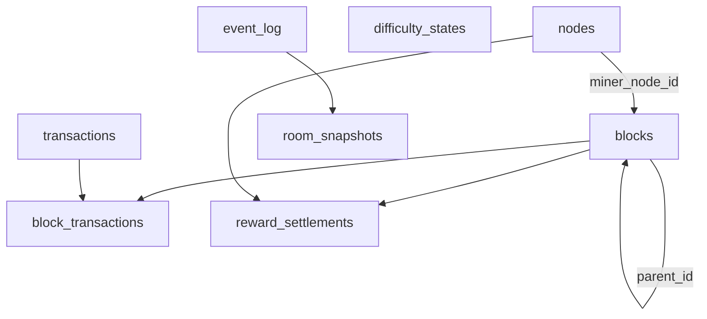

# Database Design (v1)

## Logical ERD

## Tables and key columns

- `nodes(node_id PK, hash_rate, tip_block_id, version, updated_at_ms, ...)`
- `transactions(tx_id PK, fee_sats, weight, status, created_at_ms, ...)`
- `blocks(block_id PK, parent_id FK, miner_node_id FK, cumulative_work, first_seen_seq_id, ...)`
- `block_transactions(id PK, block_id FK, tx_id FK, position, UNIQUE(block_id, position))`
- `difficulty_states(id PK, height_anchor, target, window_n, anchor_time_ms, ...)`
- `reward_settlements(id PK, block_id FK, miner_node_id FK, state, confirmations, amount_sats, ...)`
- `event_log(seq_id PK, room_id, event_type, server_time_ms, payload_json)`
- `room_snapshots(id PK, room_id, snapshot_seq_id, dag_pruned_to_height, storage_uri)`

## Indexing strategy

- `blocks(parent_id)`
- `blocks(height)`
- `blocks(cumulative_work DESC, first_seen_seq_id ASC)`
- `block_transactions(block_id, position)`
- `block_transactions(tx_id)`
- `transactions(status, created_at_ms)`
- `event_log(room_id, seq_id)`
- `reward_settlements(miner_node_id, state)`

## Domain-to-persistence mapping

- `domain::entities::Node` -> table `nodes`
- `domain::entities::Tx` -> table `transactions`
- `domain::entities::Block` -> table `blocks`
- `domain::entities::DifficultyState` -> table `difficulty_states`
- `domain::entities::RewardSettlement` -> table `reward_settlements`
