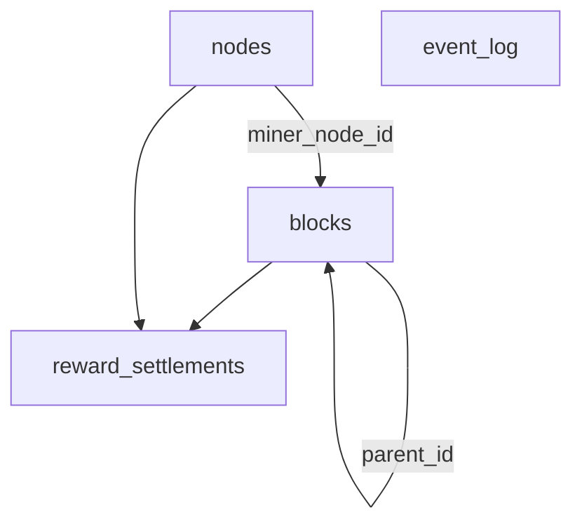

# Database Design (v1)

## Logical ERD

## Tables and key columns

- `nodes(node_id PK, hash_rate, tip_block_id, version, updated_at_ms, ...)`
- `blocks(block_id PK, parent_id FK, miner_node_id FK, cumulative_work, first_seen_seq_id, ...)`
- `reward_settlements(id PK, block_id FK, miner_node_id FK, state, confirmations, settled_at_ms, amount_sats, ...)`
- `event_log(seq_id PK, event_type, server_time_ms, payload_json)`

## Indexing strategy

- `blocks(parent_id)`
- `blocks(height)`
- `blocks(cumulative_work DESC, first_seen_seq_id ASC)`
- `event_log(seq_id)`
- `reward_settlements(miner_node_id, state)`
- `reward_settlements(block_id)` unique

## Domain-to-persistence mapping

- `domain::entities::Node` -> table `nodes`
- `domain::entities::Block` -> table `blocks`
- `domain::entities::Reward` -> table `reward_settlements`
