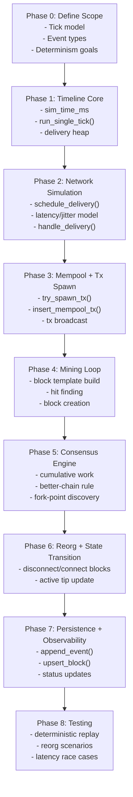
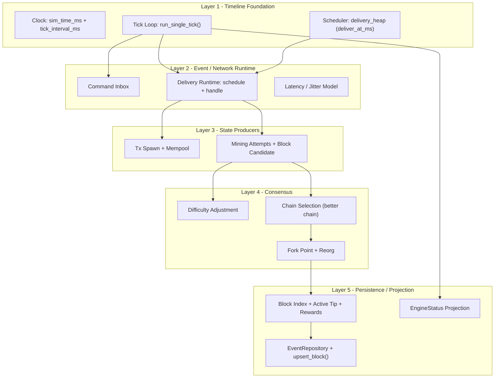
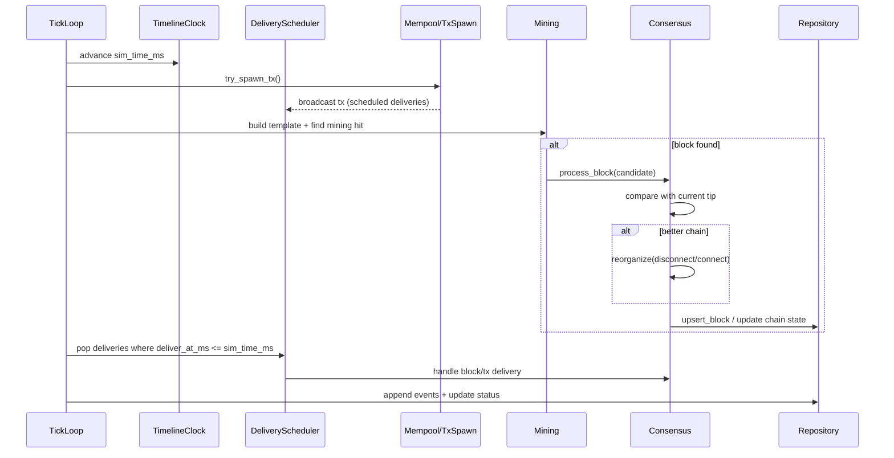

# Timeline-to-Consensus Architecture

This document describes the implementation order and runtime flow for the mining engine, with a clear separation between:

- Timeline simulation (lower layer)
- Consensus and chain selection (upper layer)

---

## 1) Implementation Roadmap (Design -> Build)

---

## 2) Layered Architecture (Timeline Below, Consensus Above)

---

## 3) Per-Tick Runtime Sequence

---

## Notes

- Timeline controls *when* events happen.
- Consensus controls *which chain wins*.
- Deterministic RNG makes runs reproducible with the same seed and config.
